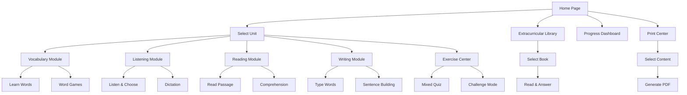

# English Genius - Product Requirements Document (PRD)

## 1. Product Overview

**English Genius** is an interactive English learning application designed for primary school students in Shanghai, based on the Shanghai Education Edition (HuJiao Ban) 2026 English textbook curriculum. The application provides an immersive, game-like learning experience that trains all four language skills: Listening, Speaking, Reading, and Writing (typing-based). All content is delivered entirely in English with no Chinese explanations - new vocabulary is taught through pronunciation (Edge TTS) and visual aids (AI-generated images).

**Target Users:** Primary school students (ages 6-12) learning English in Shanghai
**Core Value:** Making English learning fun, engaging, and effective through multimedia-rich interactive exercises

## 2. Core Features

### 2.1 Feature Module

1. **Home Page**: Welcome screen, unit/lesson navigation, progress overview, daily challenge
2. **Vocabulary Module**: Word cards with images, pronunciation, spelling practice, word games
3. **Listening Module**: Audio-based exercises, dictation, sound matching
4. **Reading Module**: Text passages, reading comprehension, extracurricular reading library
5. **Writing Module**: Typing-based writing practice, sentence construction, paragraph building
6. **Exercise Center**: Multiple question types (multiple choice, fill-in-the-blank, matching, drag-and-drop, true/false, reordering)
7. **Extracurricular Reading Library**: Extended reading materials related to each unit's topic
8. **Progress Dashboard**: Stars, badges, streak tracking, performance analytics
9. **Print Center**: Printable worksheets, vocabulary cards, practice tests

### 2.2 Question Types

| Question Type | Description | Skills Trained |
|---------------|-------------|----------------|
| Multiple Choice | Select the correct answer from 4 options | Reading, Listening |
| Fill in the Blank | Complete words or sentences by typing | Writing, Vocabulary |
| True/False | Judge if a statement is correct | Reading Comprehension |
| Matching | Match words to images, meanings, or pairs | Vocabulary, Reading |
| Drag & Drop | Reorder words into correct sentences | Writing, Grammar |
| Dictation | Listen and type what you hear | Listening, Writing |
| Image Selection | Choose the image that matches audio/text | Listening, Vocabulary |
| Sentence Building | Arrange words to form sentences | Writing, Grammar |
| Word Scramble | Unscramble letters to form words | Spelling, Vocabulary |
| Reading Comprehension | Answer questions after reading a passage | Reading |

### 2.3 Page Details

| Page Name | Module Name | Feature Description |
|-----------|-------------|---------------------|
| Home Page | Hero Section | Animated welcome with mascot, daily tip |
| Home Page | Unit Grid | Browsable unit cards with thumbnails and progress |
| Home Page | Progress Overview | Stars earned, streaks, recent activity |
| Vocabulary | Word Cards | Flip-card design with image, audio, spelling |
| Vocabulary | Word Games | Matching game, word search, flashcard quiz |
| Listening | Audio Player | Play/pause, speed control, repeat button |
| Listening | Dictation | Listen and type exercise with instant feedback |
| Reading | Text Display | Highlighted text with tap-to-define words |
| Reading | Comprehension | Questions following each passage |
| Reading | Library | Extracurricular books organized by topic and level |
| Writing | Typing Area | Guided typing with keyboard hints |
| Writing | Sentence Builder | Drag-and-drop word arrangement |
| Exercise Center | Quiz Engine | Timer, scoring, immediate feedback with explanations |
| Print Center | Worksheet Generator | Select content type, generate printable PDF |
| Dashboard | Analytics | Charts showing progress, strengths, areas to improve |

## 3. Core Process

Users start at the Home Page, select a unit from the curriculum. Each unit offers Vocabulary, Listening, Reading, and Writing sections. Users can also access the Extracurricular Reading Library for extended practice. The Exercise Center provides mixed practice across all question types. The Print Center allows generating worksheets for offline practice.

## 4. User Interface Design

### 4.1 Design Style
- **Theme:** Playful, colorful, child-friendly with a learning-focused aesthetic
- **Primary Colors:** Bright sky blue (#3B82F6), Sunny yellow (#F59E0B), Fresh green (#10B981)
- **Secondary Colors:** Soft coral (#F97316), Lavender (#8B5CF6), Pink (#EC4899)
- **Typography:** Rounded, friendly fonts - Nunito for headings, Quicksand for body text
- **Style:** Large touch targets, card-based layouts, playful illustrations, rounded corners (16px+)
- **Animations:** Bouncy micro-interactions, confetti on achievements, smooth page transitions
- **Icons:** Fun, colorful icons with emoji-style illustrations

### 4.2 Page Design Overview

| Page Name | Module Name | UI Elements |
|-----------|-------------|-------------|
| Home Page | Hero | Gradient background, animated mascot, floating clouds |
| Home Page | Unit Grid | Colorful cards with unit illustrations, progress rings |
| Vocabulary | Word Card | Large card with flip animation, speaker button, image |
| Listening | Audio Player | Custom waveform player, animated sound waves |
| Reading | Text Panel | Clean reading area, word highlighting, bookmark button |
| Writing | Typing Area | Keyboard visual, typing area with cursor animation |
| Exercise | Quiz Card | Question card with animated answer options |
| Dashboard | Stats | Animated counters, progress bars, trophy icons |
| Print | Preview | Print preview with paper effect, print button |

### 4.3 Responsiveness
- **Desktop-first** design with tablet and mobile adaptation
- Touch-optimized for tablet use (common in classroom settings)
- Large clickable areas for young users
- Keyboard navigation support for typing exercises

### 4.4 Accessibility
- High contrast mode for readability
- Large text options
- Keyboard shortcuts for navigation
- Screen reader compatible labels
