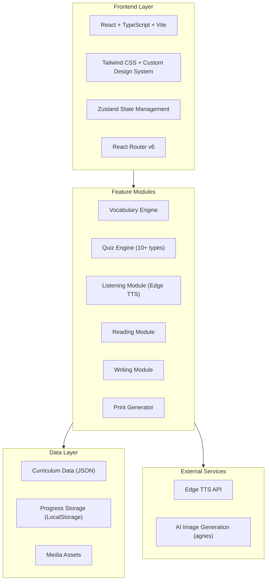

# English Genius - Technical Architecture Document

## 1. Architecture Design



## 2. Technology Description

- **Frontend Framework:** React 18 + TypeScript
- **Build Tool:** Vite 5
- **Styling:** Tailwind CSS 3 + custom CSS variables for theme
- **State Management:** Zustand
- **Routing:** React Router v6
- **Icons:** Lucide React
- **Speech:** Edge TTS (Microsoft Edge Text-to-Speech) via Web Speech API
- **Print:** React-to-print / CSS @media print
- **Animations:** CSS animations + Framer Motion
- **Data Storage:** LocalStorage for progress persistence (no backend required)
- **Image Assets:** Pre-generated via agnes AI skill + fallback SVG illustrations

## 3. Route Definitions

| Route | Purpose |
|-------|---------|
| `/` | Home page with unit navigation and overview |
| `/unit/:unitId` | Unit overview with all modules |
| `/unit/:unitId/vocabulary` | Vocabulary learning for a unit |
| `/unit/:unitId/listening` | Listening exercises for a unit |
| `/unit/:unitId/reading` | Reading passages and comprehension |
| `/unit/:unitId/writing` | Writing/typing practice |
| `/unit/:unitId/exercises` | Mixed quiz exercises |
| `/library` | Extracurricular reading library |
| `/library/:bookId` | Individual book reading view |
| `/dashboard` | Progress dashboard and analytics |
| `/print` | Print center for generating worksheets |
| `/settings` | App settings (voice, difficulty, etc.) |

## 4. Data Model

### 4.1 Curriculum Data Structure

```typescript
interface Unit {
  id: string;
  title: string;
  theme: string;
  level: number;
  thumbnail: string;
  vocabulary: VocabularyItem[];
  lessons: Lesson[];
  readings: Reading[];
  exercises: Exercise[];
}

interface VocabularyItem {
  id: string;
  word: string;
  phonetic: string;
  imageUrl: string;
  audioUrl: string;
  exampleSentence: string;
  difficulty: 'easy' | 'medium' | 'hard';
  tags: string[];
}

interface Lesson {
  id: string;
  title: string;
  content: string;
  audioScript: string;
  keyPhrases: string[];
}

interface Reading {
  id: string;
  title: string;
  content: string;
  level: 'beginner' | 'intermediate' | 'advanced';
  imageUrl: string;
  questions: Question[];
  isExtracurricular: boolean;
}

interface Exercise {
  id: string;
  type: QuestionType;
  question: string;
  options?: string[];
  correctAnswer: string | string[];
  hint?: string;
  imageUrl?: string;
  audioUrl?: string;
  points: number;
}

type QuestionType =
  | 'multiple_choice'
  | 'fill_blank'
  | 'true_false'
  | 'matching'
  | 'drag_drop'
  | 'dictation'
  | 'image_select'
  | 'sentence_building'
  | 'word_scramble'
  | 'reading_comprehension';
```

### 4.2 User Progress Data Structure

```typescript
interface UserProgress {
  userId: string;
  totalStars: number;
  currentStreak: number;
  longestStreak: number;
  unitProgress: Record<string, UnitProgress>;
  badges: Badge[];
  settings: UserSettings;
  lastActive: string;
}

interface UnitProgress {
  vocabularyMastered: string[];
  listeningCompleted: string[];
  readingCompleted: string[];
  writingCompleted: string[];
  exerciseScores: Record<string, number>;
  starsEarned: number;
  bestScore: number;
}

interface UserSettings {
  voiceSpeed: number;
  volume: number;
  difficulty: 'easy' | 'normal' | 'hard';
  showPhonetics: boolean;
  autoPlayAudio: boolean;
}
```

## 5. Project Structure

```
src/
├── components/
│   ├── layout/
│   │   ├── Header.tsx
│   │   ├── Sidebar.tsx
│   │   ├── Footer.tsx
│   │   └── Layout.tsx
│   ├── common/
│   │   ├── Button.tsx
│   │   ├── Card.tsx
│   │   ├── Modal.tsx
│   │   ├── ProgressBar.tsx
│   │   ├── StarRating.tsx
│   │   ├── AudioPlayer.tsx
│   │   ├── ImageViewer.tsx
│   │   └── Confetti.tsx
│   ├── vocabulary/
│   │   ├── WordCard.tsx
│   │   ├── WordGrid.tsx
│   │   ├── FlashCardGame.tsx
│   │   └── WordMatchGame.tsx
│   ├── listening/
│   │   ├── DictationExercise.tsx
│   │   ├── SoundMatch.tsx
│   │   └── AudioControls.tsx
│   ├── reading/
│   │   ├── TextDisplay.tsx
│   │   ├── ComprehensionQuiz.tsx
│   │   └── BookCard.tsx
│   ├── writing/
│   │   ├── TypingArea.tsx
│   │   ├── SentenceBuilder.tsx
│   │   └── KeyboardGuide.tsx
│   ├── exercises/
│   │   ├── MultipleChoice.tsx
│   │   ├── FillBlank.tsx
│   │   ├── TrueFalse.tsx
│   │   ├── Matching.tsx
│   │   ├── DragDrop.tsx
│   │   ├── WordScramble.tsx
│   │   └── QuizContainer.tsx
│   └── print/
│       ├── PrintPreview.tsx
│       └── WorksheetTemplate.tsx
├── pages/
│   ├── Home.tsx
│   ├── UnitOverview.tsx
│   ├── Vocabulary.tsx
│   ├── Listening.tsx
│   ├── Reading.tsx
│   ├── Writing.tsx
│   ├── Exercises.tsx
│   ├── Library.tsx
│   ├── BookView.tsx
│   ├── Dashboard.tsx
│   ├── PrintCenter.tsx
│   └── Settings.tsx
├── hooks/
│   ├── useTTS.ts
│   ├── useProgress.ts
│   ├── useAudio.ts
│   └── useLocalStorage.ts
├── stores/
│   ├── useAppStore.ts
│   ├── useProgressStore.ts
│   └── useSettingsStore.ts
├── data/
│   ├── units/
│   │   ├── unit1.ts
│   │   ├── unit2.ts
│   │   └── ...
│   ├── books/
│   │   ├── book1.ts
│   │   └── ...
│   └── types.ts
├── utils/
│   ├── tts.ts
│   ├── scoring.ts
│   └── helpers.ts
├── styles/
│   └── globals.css
├── App.tsx
└── main.tsx
```

## 6. Key Technical Decisions

### 6.1 Edge TTS Integration
- Use the Web Speech API (SpeechSynthesis) as the primary TTS engine
- Edge TTS voices are available through the browser's speech synthesis
- Support for child-friendly English voices (en-US, en-GB)
- Pronunciation speed control for learning pace

### 6.2 Image Generation Strategy
- Generate vocabulary images using the agnes text-to-image skill
- Images stored as base64 or URLs in the curriculum data
- Fallback to emoji/SVG illustrations when images aren't available
- Images are child-friendly, clear, and educational

### 6.3 Print Implementation
- Use CSS @media print styles for clean print layout
- React-to-print library for triggering print dialogs
- Generate worksheets with exercises, vocabulary lists, and reading passages
- Support for different paper sizes (A4, Letter)

### 6.4 State Management
- Zustand for global state (progress, settings)
- LocalStorage for data persistence
- No backend required - fully client-side application

### 6.5 Performance Considerations
- Lazy loading of images and audio assets
- Preloading of current unit's assets
- Efficient re-rendering with React.memo and useMemo
- Audio caching to avoid repeated TTS calls
